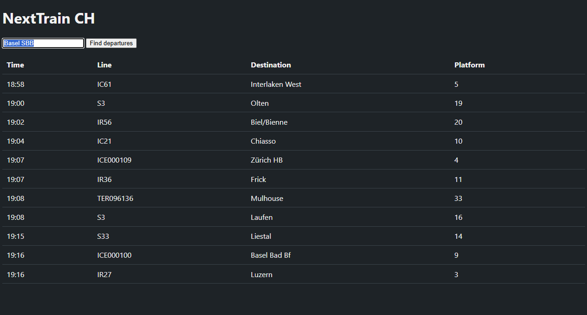

# NextTrain CH

A web app that shows the next train departures for any station in Switzerland, using live data from the Swiss public transport API.

## Live demo

https://zwangsbremsen.github.io/NextTrain-CH/

## Features

- Search any Swiss station and see its next 10 departures
- Shows departure time, line, destination and platform
- Loading, "no results" and error messages for each situation
- Responsive layout that works on desktop and mobile

## Built with

- HTML5, CSS3 and vanilla JavaScript (no frameworks)
- [transport.opendata.ch](https://transport.opendata.ch) public API
- Git and GitHub Pages for version control and hosting

## What I learned

-When the user searches for a station, the app requests its next departures from the Swiss public transport API and renders them as table rows showing time, line, destination and platform. If there are no results or the request fails, it displays a clear message instead.

- How to fetch data from a REST API with `fetch` and `async/await`, and how to navigate a JSON response
- Why script order matters: the `<script>` goes at the end of `<body>` so the DOM exists when the code looks for it
- How to handle an empty result (`if`) separately from a failed request (`try/catch`)
- How to build the table with `createElement` and `textContent` instead of `innerHTML`, so API data is always treated as text
- How to make the layout responsive with the viewport meta tag and a media query

## Roadmap

- [ ] Show delays and cancellations
- [ ] Auto-refresh every 30 seconds
- [ ] Favourite stations
- [ ] PHP + MySQL backend for user accounts

## Run the full version locally

Requirements: PHP 8+ and MySQL/MariaDB (for example via XAMPP).

1. Create the database: `mysql -u root < backend/schema.sql`
2. Start the server from the project folder: `php -S localhost:8080`
3. Open http://localhost:8080/index.html

## API endpoints

| Method | Endpoint | Description |
|---|---|---|
| POST | backend/register.php | Create an account |
| POST | backend/login.php | Log in (PHP session) |
| POST | backend/logout.php | Log out |
| GET / POST / DELETE | backend/favorites.php | List, add or remove favorite stations |

## Author

Jaime Molina Jiménez – junior web developer and former train driver.
[LinkedIn](www.linkedin.com/in/jaime-molina-jimenez)
